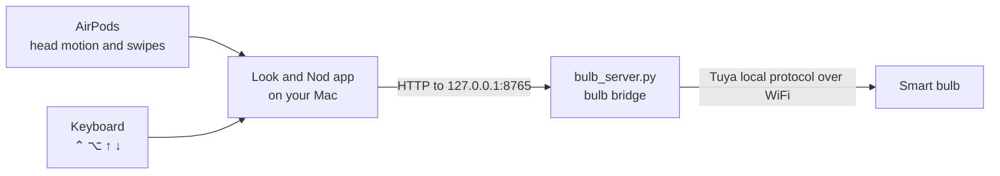

[README.md](https://github.com/user-attachments/files/33337233/README.md)
<p align="center">
  
</p>

<h1 align="center">Look and Nod</h1>

<p align="center">
  Control smart lights with your head, using the AirPods you already wear.<br>
  Look at a lamp. Nod, it's on. Shake, it's off.
</p>

<p align="center">
  
  
  
  
</p>


---

## Contents

* [What it does](#what-it-does)
* [How it works](#how-it-works)
* [What you need](#what-you-need)
* [Quick start](#quick-start)
* [Using it](#using-it)
* [The dashboard](#the-dashboard)
* [The bulb bridge](#the-bulb-bridge)
* [Project structure](#project-structure)
* [Troubleshooting](#troubleshooting)
* [Keys and safety](#keys-and-safety)
* [Ideas for next time](#ideas-for-next-time)

---

## What it does

| You do | The light does |
|---|---|
| Look at a lamp, hold **⌃ ⌥**, **nod** | Turns on |
| Look at a lamp, hold **⌃ ⌥**, **shake** | Turns off |
| Hold **⌃ ⌥**, press **↑** or **↓** | Brighter or dimmer |
| Hold **⌃ ⌥**, **swipe** up or down on your AirPods stem | Brighter or dimmer |

* **No camera.** Your AirPods' motion sensors do the tracking, and nothing records you.
* **Works in every app.** The shortcut keeps working while you're in Safari or anything else.
* **Local only.** The Mac talks to the bulbs directly over your home WiFi.
* **Two ways to pick a light.** Look at it, or choose lights to control from your desk without looking.
* **On screen pop ups** act out what you did (a nodding head, a swipe on an AirPod, a key press), like the Mac's volume pop up.

---

## How it works



1. **Head tracking.** `CMHeadphoneMotionManager` streams yaw and pitch from the AirPods. Press Recentre while facing the screen and that direction becomes 0°.
2. **Picking a light.** Each light has a saved direction. The app picks the light within **±22°** of where you're facing.
3. **Spotting gestures.** The app watches the last second of movement:
   * **Nod:** pitch dips at least 10° and comes back within 5°, with little turning.
   * **Shake:** at least two left and right swings over 16°, ending near where they started.

   A 1.4 second cooldown stops one gesture counting twice.
4. **Brightness.** A system wide keyboard tap catches ⌃ ⌥ ↑ ↓ and swallows it, so the app in front doesn't scroll. AirPods swipes arrive as volume changes. While ⌃ ⌥ is held, the app turns them into brightness steps and puts your volume back.
5. **The bridge.** A small Python server uses TinyTuya to send commands to the bulb with its local key, and replies in milliseconds.

---

## What you need

* A Mac on **macOS 14** or newer
* **AirPods Pro, AirPods Max, or AirPods 3rd generation or newer.** Swipes need AirPods Pro 2 or newer, or the Digital Crown on AirPods Max.
* Bulbs that work with the **Smart Life** or **Tuya Smart** app. Mine is a **TCP Smart RGBW** bulb.
* **Xcode** (free from the App Store)
* **Python 3** with `tinytuya`

---

## Quick start

> My bulb keys (`devices.json`, `snapshot.json`, `tinytuya.json`, `tuya-raw.json`) are saved in this repo. If you're setting up new bulbs, see [Getting new bulb keys](#getting-new-bulb-keys) first.

### 1. Start the bridge

```bash
pip3 install tinytuya
mkdir -p ~/look-and-nod && cd ~/look-and-nod
# copy bridge/bulb_server.py and the four .json key files in here
python3 bulb_server.py
```

You should see `Bulb bridge running on http://127.0.0.1:8765`. Leave this window open.

### 2. Build the app

1. In Xcode: **File → New → Project → macOS → App**.
2. Replace `ContentView.swift` with [`app/ContentView.swift`](app/ContentView.swift).
3. In the **Info** tab, add **Privacy - Motion Usage Description** with any sentence.
4. In **Signing & Capabilities**, delete **App Sandbox** using the bin icon. The app can't catch keys in other apps or read volume changes with it on.
5. Press **▶ Run**.

Or skip Xcode completely:

```bash
bash app/build.sh    # makes build/Look and Nod.app
```

### 3. Allow permissions

* **Motion & Fitness:** allow it when asked.
* **System Settings → Privacy & Security → Accessibility:** turn on the app.

---

## Using it

The **Get started** checklist in the app ticks off each step.

1. Put your AirPods in, face the screen and press **Recentre** (or the R key).
2. Turn to a lamp and press **Save Direction** on its card.
3. Hold **⌃ ⌥**, look at the lamp and **nod** or **shake**.
4. Hold **⌃ ⌥** and press **↑ ↓**, or swipe your AirPods, for brightness.

### Settings

| Setting | Options |
|---|---|
| **Listen** | **Hold ⌃ ⌥** only listens while you hold the keys. **Always** listens all the time, but can catch normal head movement. |
| **Choose a light** | **Look to pick** uses the lamp you're facing. **From desk** controls one chosen light, or all of them, without looking. |
| **Pop ups** | Turn the on screen pop ups on or off (in the slider menu at the top). |
| **Gestures** | Pause everything (in the same menu). |

Settings and saved directions are remembered between launches. Press Recentre each time you open the app.

---

## The dashboard

| Panel | Shows |
|---|---|
| **Your room** | You from above, a cone showing where you're looking, each lamp in its saved direction, glowing when on |
| **Head movement** | A live trace: blue for nods, teal for shakes, with markers when a gesture is recognised |
| **From your head to the light** | The four steps of each command (AirPods → Gesture → Bridge → Light) with the bulb's real reply time |
| **Lights** | On/off switch, brightness slider, Save Direction and Forget for each bulb |
| **Activity** | Everything that happened, what triggered it and how fast the bulb replied |

The header shows green or orange dots for **AirPods**, **Bridge** and **Shortcut**. Hover over each for details.

---

## The bulb bridge

`bridge/bulb_server.py` runs on `http://127.0.0.1:8765`. You can also test it from a browser or `curl`.

| Request | Does |
|---|---|
| `GET /devices` | Lists the bulbs and their names |
| `GET /<name>/on` | Switches on |
| `GET /<name>/off` | Switches off |
| `GET /<name>/toggle` | Switches to the opposite |
| `GET /<name>/status` | Raw status from the bulb |
| `GET /<name>/step/10` | 10% brighter (`-10` for dimmer) |
| `GET /<name>/brightness/50` | Sets 50% |

Bulb names come from the Smart Life app, in lower case with dashes. Mine is `bulb-rgbw`.

```bash
curl http://127.0.0.1:8765/bulb-rgbw/on
```

`bridge/bulb_test.py` runs the bulb through off, on, red, green, white and dim, to check it works.

The version in `setup-kit/` also finds the bulb again automatically if the router gives it a new IP address.

### Getting new bulb keys

1. Add the bulb in the **Smart Life** app.
2. At [iot.tuya.com](https://iot.tuya.com), create a cloud project:
   * Development method: **Smart Home**
   * Data centre: **Central Europe**
3. In the project, go to **Devices → Link App Account** and scan the QR code **inside the Smart Life app** (Me, then the scan icon).
4. Run the wizard and paste the Access ID, Access Secret and a Device ID, with region `eu`. Answer Y to both questions.

```bash
python3 -m tinytuya wizard
```

This writes fresh `devices.json`, `snapshot.json`, `tinytuya.json` and `tuya-raw.json`. Re-pairing a bulb in Smart Life changes its key, so run the wizard again if you ever do.

---

## Project structure

```
look-and-nod/
├── app/                 Mac app (latest dashboard)
│   ├── ContentView.swift      everything: tracking, gestures, dashboard, pop ups
│   ├── LookAndNodApp.swift    app entry point (for build.sh)
│   ├── Info.plist
│   ├── AppIcon.iconset/
│   └── build.sh               builds the .app without Xcode
├── bridge/              bulb_server.py and bulb_test.py
├── setup-kit/           one double click setup for other people
├── older-versions/      first simple app, and an Apple Home (Shortcuts) version
├── web-demo/            browser version using the webcam instead of AirPods
├── website/             landing page and dashboard screenshot
├── video/               first demo video
└── *.json               my bulb keys (private)
```

---

## Troubleshooting

| Problem | Fix |
|---|---|
| **Bridge** is orange | Start `python3 bulb_server.py`. Check nothing else is using port 8765. |
| Bridge runs but the bulb ignores it | Check the bulb is on at the wall and on the same WiFi. Try `python3 bulb_test.py`. If its IP changed, run `python3 -m tinytuya scan` and the wizard again. |
| **Shortcut** is orange | In Accessibility, remove the app with **−**, add it again, then reopen the app. App Sandbox must be off. |
| **AirPods** is orange | Connect them to the Mac, not your phone. Play a sound for a second. Allow Motion & Fitness. |
| Nods aren't recognised | Hold ⌃ ⌥ (unless Listen is Always), and make the nod a clear dip and return. Check the Head movement graph. |
| Wrong light reacts | Press Recentre while facing the screen, then Update Direction for that light. |
| AirPods swipe does nothing | Swipes need AirPods Pro 2 or newer. Hold ⌃ ⌥ while swiping. |
| Saved directions vanished | Normal after turning App Sandbox off (settings move location). Save them again. |
| Built app is laggy | Use the latest `ContentView.swift`. Head movement only redraws the room view. |

---

## Keys and safety

The four `.json` files contain my **bulb keys** and **Tuya API secret**. With them, anyone can control my bulbs, and the API secret gives access to my Tuya cloud account.

* **Keep this repo private.**
* Before ever making it public, delete those files and change the secret in the Tuya project (**Overview → Reset Access Secret**).

---

## Ideas for next time

* Colour changes: a double nod cycles colours on RGBW bulbs
* Scenes: look at the TV and nod for a "film" scene
* Apple Home support, so any HomeKit light works (started in `older-versions/`)
* Learn each person's own nod size
* A menu bar version with no window

---

<p align="center">Built by <b>Eben Amanuel</b> · Product Design Engineering, Liverpool John Moores University</p>
